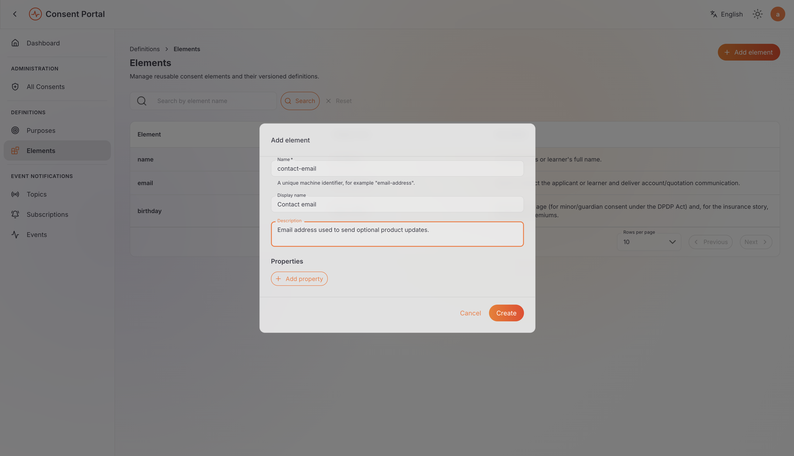
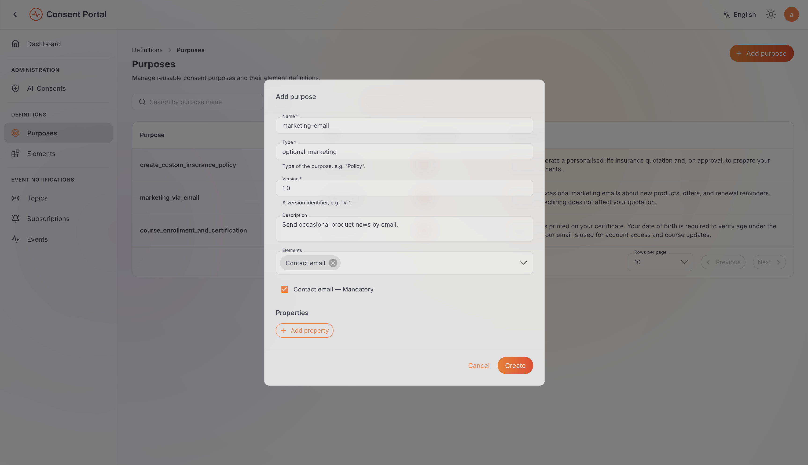
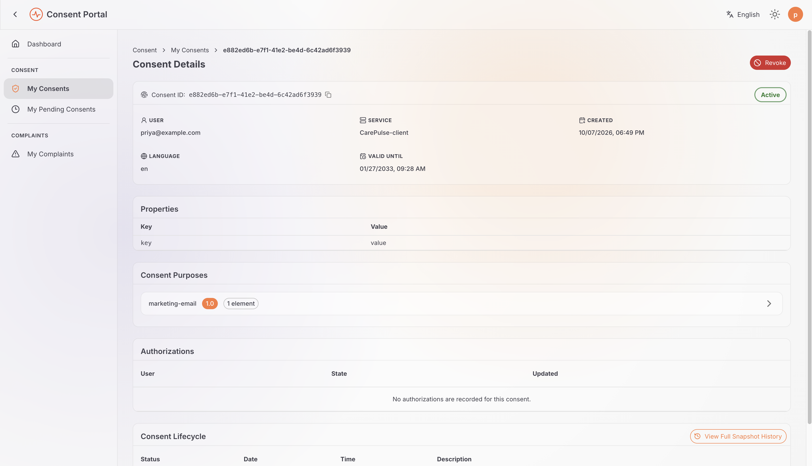
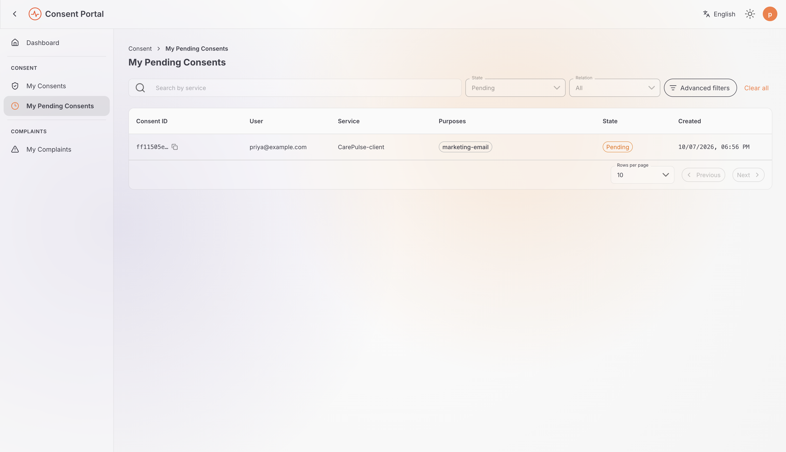
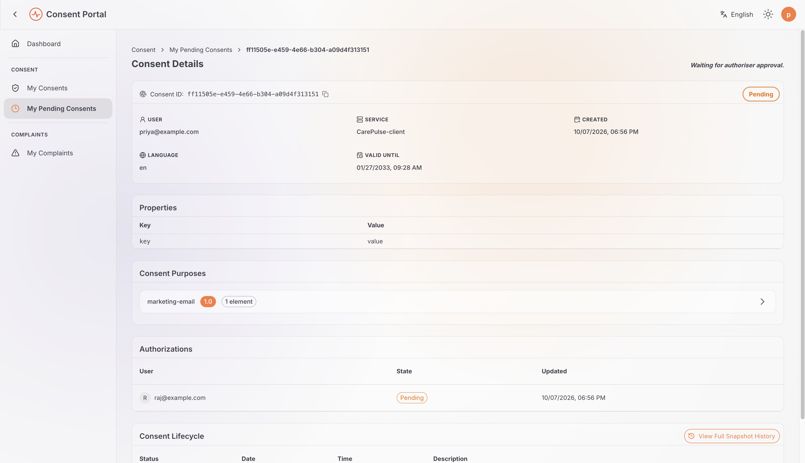
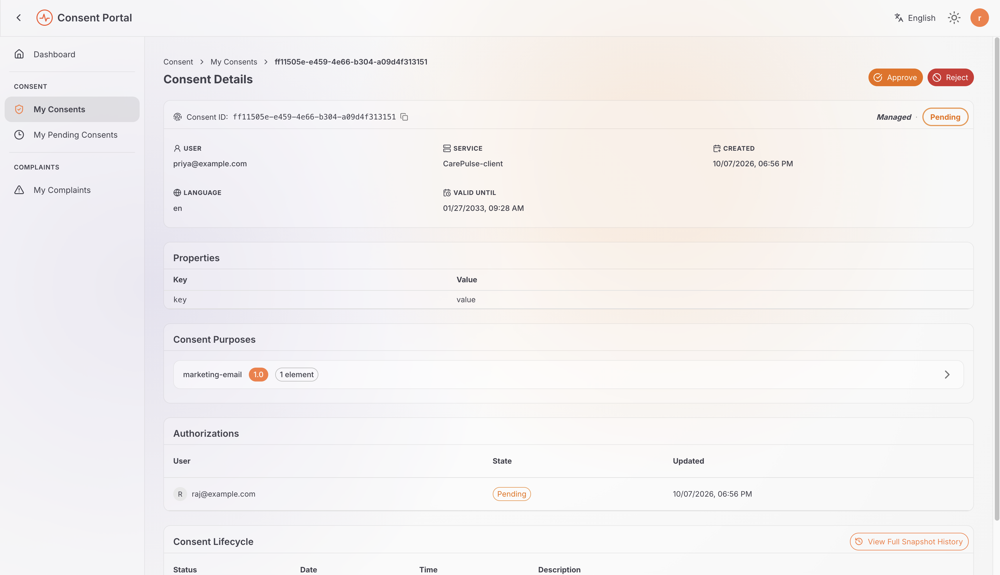
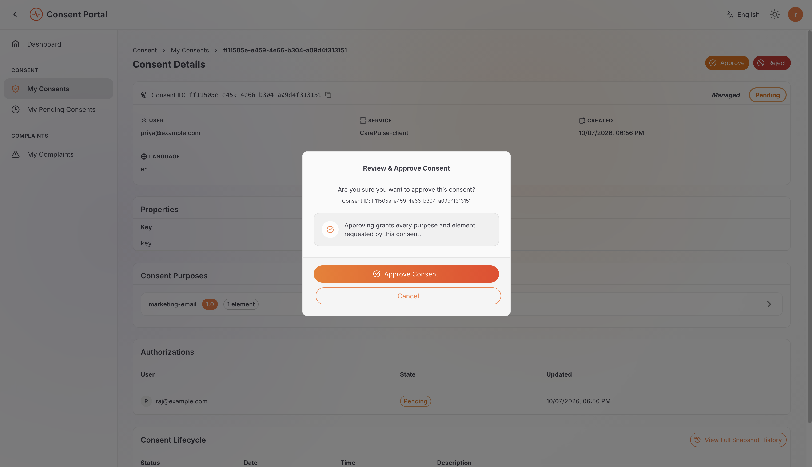
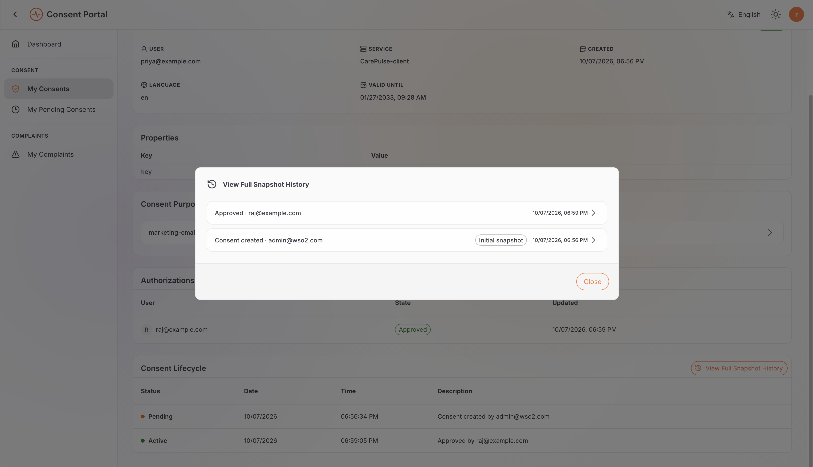

# Consent Management

Explore how the DPDP Accelerator handles consent, from defining purposes and data elements to reviewing, authorizing, revoking, and auditing consent records.

The examples use **CarePulse**, with **Priya** as the Data Principal and **Raj** as an additional authorizer. The Consent Portal supports consent administration and self-service but does not create consent records; these must be created through a connected application or the Consent Management API.

## Before you begin

- Ensure you can access the DPDP Accelerator and Consent Portal.
- For delegated and co-authorized consent, create test accounts for Priya and Raj in the same tenant.

The steps focus on the portal UI. **Equivalent REST API examples are included to demonstrate how to perform the same operations programmatically.** For these examples, follow [Managing Access](../learn/managing-access.md) to obtain a client-credentials token for the **DPDP Consent API Invoker**.

Set your API base URL and token when trying the API examples:

```bash
export BASE_URL="https://<your-is-host>"
export INVOKER_ACCESS_TOKEN="<client-credentials-token>"
```

## Choose a flow

1. [Define a purpose and its data element](#define-a-purpose-and-its-data-element) — configure the data and purpose used by the consent examples.
2. [Review, authorize, revoke, and audit a consent](#review-authorize-revoke-and-audit-a-consent) — create and manage a direct consent, then inspect its history.
3. [Authorize consent as a guardian or delegate](#authorize-consent-as-a-guardian-or-delegate) — create a consent that another person must authorize.
4. [Create a co-authorized consent](#create-a-co-authorized-consent) — require the Data Principal and another person to authorize the same consent.

Complete the shared purpose-and-element setup once. The direct, delegated, and co-authorized consent flows all reuse those identifiers.

## Define a purpose and its data element

This flow shows how a Data Fiduciary defines why personal data is requested and which data element is involved. You can perform the setup in the portal or call the equivalent REST APIs.

### Create an element

1. Sign in to the Consent Portal as the portal administrator.
2. Open **Elements** and select **Add Element**.
3. Enter the following values:

   | Field | Example |
   |---|---|
   | Name | `contact-email` |
   | Display name | `Contact email` |
   | Description | `Email address used to send optional product updates.` |

4. Select **Create**.
5. Open the resulting row and note its identifier. You will use that ID when creating the purpose.



#### Create the element using the REST API (optional)

Use this alternative only if you want to create the element through the API instead of the portal. Replace `${ADMIN_ACCESS_TOKEN}` with an administrator token that has the required catalog permissions. The response's `id` is the element ID; keep it for the next step.

```bash
curl -X POST \
  "${BASE_URL}/api/identity/consent-mgt/v2.0/elements" \
  -H "Authorization: Bearer ${ADMIN_ACCESS_TOKEN}" \
  -H "Content-Type: application/json" \
  -d '{
    "name": "contact-email",
    "displayName": "Contact email",
    "description": "Email address used to send optional product updates."
  }'
```

Representative response (the ID will differ in your environment):

```json
{
  "id": "b9dd5f0d-4981-4d56-86b6-65b5d8d32e24",
  "name": "contact-email",
  "displayName": "Contact email",
  "description": "Email address used to send optional product updates."
}
```

### Create a purpose

1. Open **Purposes** and select **Add Purpose**.
2. Enter the following values:

   | Field | Example |
   |---|---|
   | Name | `marketing-email` |
   | Type | `optional-marketing` |
   | Version | `1.0` |
   | Description | `Send occasional product news by email.` |

3. In the element selector, add `contact-email` and choose whether it is mandatory for this purpose. In this example, it is optional.
4. Select **Create**.
5. Open the purpose and confirm that version `1.0` references the expected element.



#### Create the purpose using the REST API (optional)

Use this alternative only if you want to create the purpose through the API instead of the portal. Replace `${ADMIN_ACCESS_TOKEN}` with an administrator token that has the required catalog permissions, and replace `<element-id>` with the `id` returned when you created `contact-email`.

```bash
curl -X POST \
  "${BASE_URL}/api/identity/consent-mgt/v2.0/purposes" \
  -H "Authorization: Bearer ${ADMIN_ACCESS_TOKEN}" \
  -H "Content-Type: application/json" \
  -d '{
    "name": "marketing-email",
    "type": "optional-marketing",
    "version": "1.0",
    "description": "Send occasional product news by email.",
    "elements": [
      {
        "id": "<element-id>",
        "mandatory": false
      }
    ]
  }'
```

Representative response (the IDs will differ in your environment):

```json
{
  "id": "d223f77a-54ed-4099-99b2-9900795483ae",
  "name": "marketing-email",
  "description": "Send occasional product news by email.",
  "type": "optional-marketing",
  "latestVersion": {
    "id": "787c0c69-7a84-4a62-b5f1-3706ce818d72",
    "version": "1.0"
  },
  "elements": [
    {
      "id": "b9dd5f0d-4981-4d56-86b6-65b5d8d32e24",
      "name": "contact-email",
      "displayName": "Contact email",
      "mandatory": false
    }
  ]
}
```

Expected result: the purpose and element appear in the tenant's configuration and can be referenced by a connected application when it creates a consent. Keep both returned IDs for the following flows.

> **Important:** The portal does not have an **Add Consent** action. A consent is created by a connected application or through WSO2 Identity Server's Consent Management v2 API. The automatically provisioned **DPDP Consent API Invoker** application supports machine-to-machine access to the consents resource. See [Consent API Invoker provisioning](../install-and-setup/configuring-the-accelerator.md#consent-api-invoker-provisioning).

## Review, authorize, revoke, and audit a consent

In this flow, create a **Direct Consent** for Priya, review it as the Data Principal, revoke it, and inspect the administrative record and status history.

A Direct Consent has no named authorizers, so it becomes `ACTIVE` immediately. Consent creation is an API operation; the portal is used to review and manage the resulting record.

### Create a direct consent

Use the Consent API Invoker's client-credentials token. Replace `<marketing-email-purpose-id>` and `<contact-email-element-id>` with the IDs returned in the previous flow.

```bash
curl -X POST \
  "${BASE_URL}/api/identity/consent-mgt/v2.0/consents" \
  -H "Authorization: Bearer ${INVOKER_ACCESS_TOKEN}" \
  -H "Content-Type: application/json" \
  -d '{
    "subjectId": "priya@example.com",
    "serviceId": "CarePulse-client",
    "purposes": [
      {
        "id": "<marketing-email-purpose-id>",
        "elements": [
          { "id": "<contact-email-element-id>" }
        ]
      }
    ],
    "language": "en",
    "expiryTime": 1990411096000,
    "authorizations": [],
    "properties": {}
  }'
```

Retain the returned consent ID for the next steps. The sample `expiryTime` is a Unix timestamp in milliseconds (27 January 2033, UTC). Replace it with a future timestamp appropriate for your test environment if needed.

### Review and validate the consent as Priya

1. Sign in to the Consent Portal as Priya.
2. Open **All Consents** and select the Direct Consent created above.
3. Review its metadata, properties, purposes, and data elements. An empty authorizations table confirms that no additional person needs to approve it.
4. In **Consent Lifecycle**, confirm that the timeline records the consent's creation.



You can also retrieve the consent through the user-scoped API. This call is optional if you have already reviewed it in the portal. To run it, replace `${PRIYA_ACCESS_TOKEN}` with Priya's user token and `<consent-id>` with the ID returned during creation.

```bash
curl \
  "${BASE_URL}/api/users/v1/me/consents/<consent-id>" \
  -H "Authorization: Bearer ${PRIYA_ACCESS_TOKEN}"
```

Before relying on a consent for processing, the consuming application should check that the consent is `ACTIVE`, that the intended processing purpose is covered, and that the required data elements are included. Creating or retrieving a consent does not, by itself, enforce those checks in a downstream application.

### Revoke the consent as Priya

1. On the consent detail page, select **Revoke** and confirm the action.
2. Reopen the record and verify that its state is `REVOKED` and the lifecycle section includes the corresponding audit entry.

The equivalent API request is optional. To run it, replace `${PRIYA_ACCESS_TOKEN}` with Priya's user token:

```bash
curl -X POST \
  "${BASE_URL}/api/users/v1/me/consents/<consent-id>/revoke" \
  -H "Authorization: Bearer ${PRIYA_ACCESS_TOKEN}"
```

Revocation has no required request or response body. With lifecycle event publication enabled, a supported revocation lifecycle path publishes `consent.revoke`.

### Inspect the consent as an administrator

1. Sign in to the Consent Portal as the portal administrator.
2. Open **Administration → Consents**.
3. Filter by consent ID, user, state, service, purpose, or the available advanced filters.
4. Open the consent and compare the tenant-wide administrative view with Priya's self-service view.

The self-service view returns consents involving the signed-in user. The administrative registry is tenant-wide and requires the appropriate administrative consent permissions.

### Inspect the status history

You can also use the DPDP Consent Management API to verify the lifecycle history independently of the portal. This call is optional; to run it, replace `${ADMIN_ACCESS_TOKEN}` with an administrator token that has the required scopes.

```bash
curl \
  "${BASE_URL}/api/dpdp/consent-mgt/v1/consents/<consent-id>/status-history?limit=100&offset=0" \
  -H "Authorization: Bearer ${ADMIN_ACCESS_TOKEN}"
```

Representative response after revocation (the IDs and timestamps will differ in your environment):

```json
{
  "consentId": "81c6dcb8-3df9-4b15-a43e-50f253792dbe",
  "statusHistory": [
    {
      "previousStatus": "ACTIVE",
      "currentStatus": "REVOKED",
      "actionType": "REVOKE",
      "actionBy": "priya@example.com",
      "actionTime": 1788230520000
    }
  ],
  "pagination": {
    "limit": 100,
    "offset": 0,
    "totalCount": 1
  }
}
```

Expected result: the consent is `REVOKED`, and the status history records the transition from `ACTIVE` to `REVOKED`.

## Authorize consent as a guardian or delegate

A **Delegated Consent** names someone other than the Data Principal as the authorizer. The Data Principal can see the consent but is not asked to make the authorization decision. In this example, CarePulse creates a consent for Priya and names Raj as the person who must authorize it.

The API stores the subject and the required authorizers; it does not verify that an authorizer is actually a parent, lawful guardian, or other representative. A trusted Data Fiduciary system must verify that relationship before creating the delegated authorization.


### Create a delegated consent

Before you begin, ensure that Priya and Raj have separate test accounts in the same tenant. Create the consent with the Consent API Invoker's client-credentials token, using the purpose and element IDs from [Define a purpose and its data element](#define-a-purpose-and-its-data-element).

```bash
curl -X POST \
  "${BASE_URL}/api/identity/consent-mgt/v2.0/consents" \
  -H "Authorization: Bearer ${INVOKER_ACCESS_TOKEN}" \
  -H "Content-Type: application/json" \
  -d '{
    "subjectId": "priya@example.com",
    "serviceId": "CarePulse-client",
    "purposes": [
      {
        "id": "<marketing-email-purpose-id>",
        "elements": [
          { "id": "<contact-email-element-id>" }
        ]
      }
    ],
    "language": "en",
    "expiryTime": 1990411096000,
    "authorizations": [
      { "userId": "raj@example.com", "type": "USER" }
    ],
    "properties": {}
  }'
```

Retain the returned consent ID. Do not add Priya as another entry in `authorizations`: `subjectId` already identifies the person whose data the consent concerns, while `authorizations` contains the additional people who must decide on that person's behalf. When at least one authorization is supplied, Identity Server stores the new consent as `PENDING`.

### Observe the consent as Priya

1. Sign in to the Consent Portal as Priya and open **Pending Consents**.

   

2. Open the consent. Because Priya is not a named authorizer, the page explains that it is waiting for authorization instead of showing Approve/Reject actions.

   

### Approve as Raj, the delegate

1. Sign in to the Consent Portal as Raj, the authorizer. Open the consent from **My Consents**, filtered to **Managed**, or open **My Pending Consents**.
2. Confirm the Data Principal, service, purpose, data elements, and authorization entry. Raj sees Approve/Reject actions that Priya does not.

   

3. Select **Approve** and confirm.

   

4. Reopen the consent and confirm that Raj's authorization is `APPROVED`. Because Raj is the only required authorizer in this example, the aggregate consent becomes `ACTIVE`. If several authorizers were supplied, it would remain `PENDING` until all required authorizers approved.

Optional API alternative: Raj can inspect his pending consents through the user-scoped API. Replace `${RAJ_ACCESS_TOKEN}` with Raj's user token:

```bash
curl \
  "${BASE_URL}/api/users/v1/me/consents?state=PENDING&relation=AUTHORIZER&attributes=purposes,authorizations" \
  -H "Authorization: Bearer ${RAJ_ACCESS_TOKEN}"
```

Alternatively, approve the consent through the API using Raj's user token. Replace `${RAJ_ACCESS_TOKEN}` and `<consent-id>` with the appropriate values:

```bash
curl -X POST \
  "${BASE_URL}/api/users/v1/me/consents/<consent-id>/authorize" \
  -H "Authorization: Bearer ${RAJ_ACCESS_TOKEN}" \
  -H "Content-Type: application/json" \
  -d '{ "state": "APPROVED" }'
```

A successful authorization has no required response body.

### Verify the result as Priya

1. Sign back in to the Consent Portal as Priya.
2. Open **My Consents** and choose **Personal**.
3. Open the consent and verify that it is `ACTIVE` and records Raj's approved authorization.
4. Inspect **Consent Lifecycle** and **View Full Snapshot History** to confirm that the authorization and aggregate state transition were audited.

   

Optional API alternative — the equivalent subject-scoped query uses Priya's user token:

```bash
curl \
  "${BASE_URL}/api/users/v1/me/consents?relation=SUBJECT&attributes=purposes,authorizations" \
  -H "Authorization: Bearer ${PRIYA_ACCESS_TOKEN}"
```

Expected result: Priya and Raj can see the same consent through different relationships. Only the named authorizer can record the delegated decision, and the consent becomes active only after all required authorizers approve it. Relationship validation and downstream enforcement remain the Data Fiduciary's responsibility; this flow demonstrates consent storage, authorization, state resolution, and audit behavior in the accelerator.

## Create a co-authorized consent

Unlike delegated consent, a **Co-authorized Consent** names the Data Principal as one of the authorizers alongside at least one other person. In this example, both Priya and Raj must approve the same consent.

### Create the co-authorized consent

Use the Consent API Invoker's client-credentials token and the purpose and element IDs from [Define a purpose and its data element](#define-a-purpose-and-its-data-element). The `authorizations` list includes both Priya and Raj.

```bash
curl -X POST \
  "${BASE_URL}/api/identity/consent-mgt/v2.0/consents" \
  -H "Authorization: Bearer ${INVOKER_ACCESS_TOKEN}" \
  -H "Content-Type: application/json" \
  -d '{
    "subjectId": "priya@example.com",
    "serviceId": "CarePulse-client",
    "purposes": [
      {
        "id": "<marketing-email-purpose-id>",
        "elements": [
          { "id": "<contact-email-element-id>" }
        ]
      }
    ],
    "language": "en",
    "expiryTime": 1990411096000,
    "authorizations": [
      { "userId": "priya@example.com", "type": "USER" },
      { "userId": "raj@example.com", "type": "USER" }
    ],
    "properties": {}
  }'
```

Retain the returned consent ID. Because authorizers are specified, the consent starts as `PENDING`, even though the subject is also an authorizer.

### Approve as Priya

1. Sign in as Priya and open **My Consents**, filtered to **Managed**.
2. Approve Priya's own authorization entry in the UI. If you prefer the API, run the optional request below using Priya's user token:

```bash
curl -X POST \
  "${BASE_URL}/api/users/v1/me/consents/<consent-id>/authorize" \
  -H "Authorization: Bearer ${PRIYA_ACCESS_TOKEN}" \
  -H "Content-Type: application/json" \
  -d '{ "state": "APPROVED" }'
```

Reopen the consent and confirm that Priya's decision is recorded. The overall consent remains `PENDING` until Raj also makes his decision.

### Approve as Raj

1. Sign in as Raj and open the same consent from **My Consents**, filtered to **Managed**, or from **My Pending Consents**.
2. Review the consent and approve Raj's own authorization entry in the UI. If you prefer the API, run the optional request below using Raj's user token:

```bash
curl -X POST \
  "${BASE_URL}/api/users/v1/me/consents/<consent-id>/authorize" \
  -H "Authorization: Bearer ${RAJ_ACCESS_TOKEN}" \
  -H "Content-Type: application/json" \
  -d '{ "state": "APPROVED" }'
```

### Verify the result

Reopen the consent as Priya or Raj. With both authorizations `APPROVED`, the aggregate consent becomes `ACTIVE`. Both named authorizers are required to approve independently before it becomes active.

This differs from the other models:

- **Direct Consent:** no named authorizers; the consent becomes `ACTIVE` immediately.
- **Delegated Consent:** the subject is not a named authorizer; another person makes the authorization decision.
- **Co-authorized Consent:** the subject and at least one other person are named authorizers and must each make a decision.

## Next Steps

- **[Learn: Understanding Consent](../learn/consent.md):** Review the concepts behind consent collection, authorization, withdrawal, and enforcement.
- **[Try Out: Complaint Management](complaint.md):** Submit and manage a grievance.
- **[Try Out: All Flows](event.md):** Continue with the end-to-end guide covering consents and event notifications.
